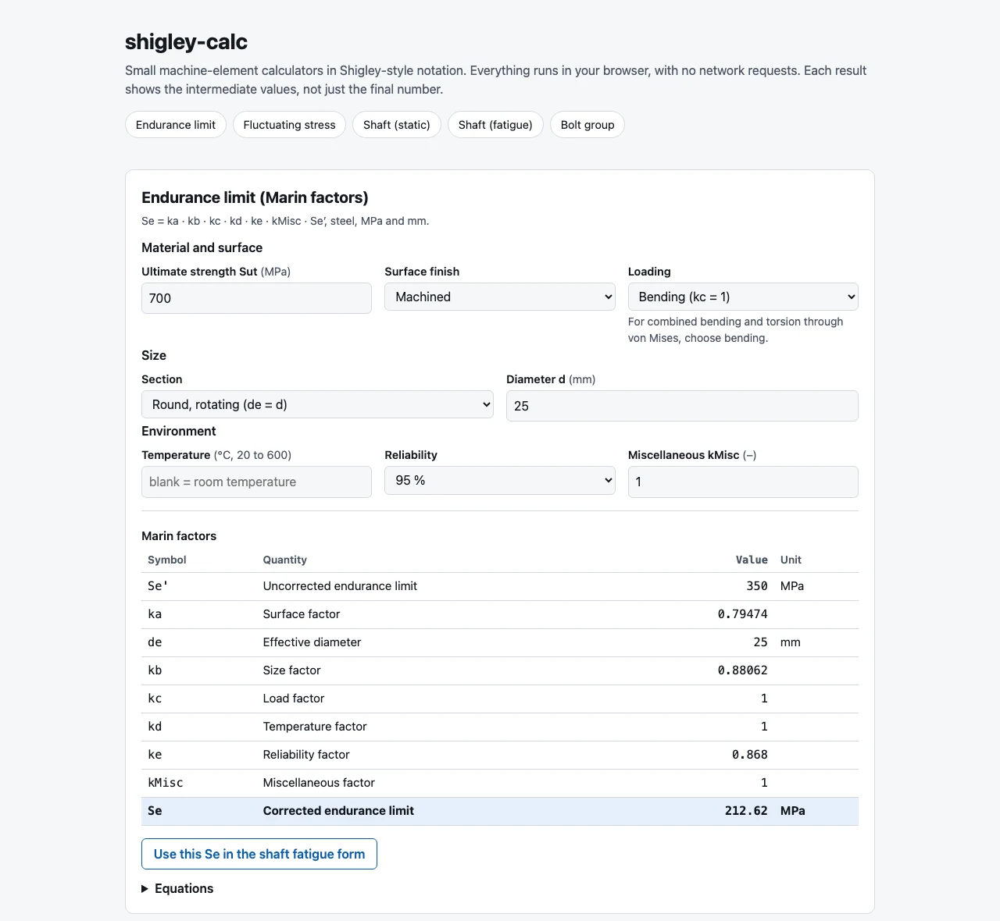

<h1 align="center">shigley-calc</h1>

<p align="center">
  <b>Machine-element calculators in Shigley notation: endurance limit, fatigue criteria, shaft diameters and eccentric bolt groups.<br>
  A tested, dependency-free JavaScript library, plus an offline web page that shows every intermediate value.</b>
</p>

<p align="center">
  <a href="https://github.com/yuroka-studio/shigley-calc/actions/workflows/ci.yml"></a>
  
  
  = 22">
</p>

<p align="center">
  <a href="#quickstart">Quickstart</a> ·
  <a href="#what-it-calculates">Calculators</a> ·
  <a href="#examples">Examples</a> ·
  <a href="#equations">Equations</a> ·
  <a href="#türkçe">Türkçe</a>
</p>

<p align="center">
  <picture>
    <source media="(prefers-color-scheme: dark)" srcset="docs/screenshot-dark.webp">
    
  </picture>
</p>

> **Educational tool.** Read the [disclaimer](#disclaimer) before relying on any number from this library.

## What it calculates

| Calculator | You give | You get |
| --- | --- | --- |
| **Endurance limit** | `Sut`, surface finish, size, load type, temperature, reliability | `Se'`, every Marin factor (`ka` to `ke`), corrected `Se` |
| **Fatigue criteria** | `σa` and `σm` (or `σmax` and `σmin`), `Se`, `Sut`, `Sy` | factor of safety for Goodman, Soderberg, Gerber, ASME-elliptic and Langer |
| **Shaft, static** | `M`, `T`, `Sy`, target `n` | diameter, or the factor of safety at a given diameter |
| **Shaft, fatigue** | `Ma`, `Mm`, `Ta`, `Tm`, `Kf`, `Kfs`, `Se` (a number or a function of `d`), `Sut`, `Sy`, target `n` | DE-Goodman, DE-Soderberg, DE-Gerber and DE-ASME-elliptic diameters, or the factors of safety at a given diameter |
| **Bolt group in shear** | bolt positions, the force and its line of action, an optional couple | centroid, primary and secondary shear on every bolt, the critical bolt |

Every function is pure and returns its intermediate values too, so you can check a result step by step. Invalid input (a negative stress, an unknown surface finish, a diameter outside the validity range, ...) throws a `RangeError` that names the parameter.

## Quickstart

**The web page.** Browsers refuse to load ES modules from `file://` URLs, so serve the folder over http:

```sh
git clone https://github.com/yuroka-studio/shigley-calc
cd shigley-calc
npm start          # http://127.0.0.1:8080/ (or: python3 -m http.server 8080)
```

The page makes no network requests and follows your light or dark theme. If the modules can't load, it shows a banner that explains why. It also works unchanged on any static host such as GitHub Pages.

**The library.** Node.js 22 or newer, or any current browser. Plain ES modules with JSDoc, no build step.

```sh
npm install github:yuroka-studio/shigley-calc
```

```js
import { enduranceLimit, deGoodmanDiameter } from 'shigley-calc';

// Ma = 120 N·m bending, Tm = 80 N·m steady torque, machined steel with Sut = 600 MPa,
// 99 % reliability, design factor 2. Se depends on d, so pass a function and the library iterates.
deGoodmanDiameter({
  Ma: 120e3, Tm: 80e3, Kf: 1.7, Kfs: 1.5, Sut: 600, n: 2,
  Se: (d) => enduranceLimit({ Sut: 600, finish: 'machined', d, reliability: 0.99 }).Se,
});
// { criterion: 'goodman', d: 30.13, A: 408000, B: 207846, Se: 174.52, iterations: 8 }
```

From a clone, import from `./src/index.mjs` instead.

## Units

Everything is SI with the units that keep the arithmetic consistent (N/mm² = MPa), so there are no hidden conversions inside the library.

| Quantity | Unit |
| --- | --- |
| stress, strength | MPa |
| length, diameter, coordinates | mm |
| force | N |
| moment, torque | N·mm (the demo page converts from N·m) |
| temperature | °C |
| factors (`ka`, `n`, `Kf`, ...) | dimensionless |

## Examples

### Endurance limit (`endurance.mjs`)

```js
import { enduranceLimit } from 'shigley-calc';

const marin = enduranceLimit({
  Sut: 700,            // MPa
  finish: 'machined',  // 'ground' | 'machined' | 'cold-drawn' | 'hot-rolled' | 'as-forged'
  d: 25,               // mm, rotating round (use `de` for an effective diameter instead)
  load: 'bending',     // 'bending' | 'axial' | 'torsion'
  reliability: 0.95,   // fraction; tabulated values only
});
// { SePrime: 350, ka: 0.7947, kb: 0.8806, kc: 1, kd: 1, ke: 0.868, kMisc: 1, de: 25, Se: 212.62 }
```

The individual factors are exported too: `uncorrectedEnduranceLimit`, `surfaceFactor`, `sizeFactor`,
`equivalentDiameterRound`, `equivalentDiameterRectangle`, `loadFactor`, `temperatureFactor`,
`reliabilityFactor`, `reliabilityFactorFromZ` and `correctedEnduranceLimit`.

### Fatigue criteria (`fatigue.mjs`)

```js
import { stressComponents, fluctuatingSafetyFactors } from 'shigley-calc';

const { sigmaA, sigmaM } = stressComponents(150, 10); // sigmaMax, sigmaMin  ->  70, 80 MPa
fluctuatingSafetyFactors({ sigmaA, sigmaM, Se: 212.6, Sut: 700, Sy: 560 });
// { goodman: 2.25, soderberg: 2.12, gerber: 2.74, asmeElliptic: 2.79, langer: 3.73 }
```

`vonMisesComponents({ sigmaA, sigmaM, tauA, tauM, Kf, Kfs })` combines bending and torsion, and
`fatigueConcentrationFactor(Kt, q)` gives `Kf = 1 + q (Kt - 1)`.

### Shafts (`shaft.mjs`)

```js
import { staticShaftDiameter, deGoodmanDiameter, shaftFatigueSafetyFactor, enduranceLimit } from 'shigley-calc';

// Static: moments in N*mm
staticShaftDiameter({ M: 100e3, T: 200e3, Sy: 350, n: 2.5 }).d;      // 24.41 mm

// Fatigue with a known Se
const loads = { Ma: 100e3, Tm: 60e3, Kf: 1.6, Kfs: 1.4, n: 2, Sut: 500 };
deGoodmanDiameter({ ...loads, Se: 150 }).d;                           // 29.12 mm

// Fatigue where Se depends on the diameter: pass a function, the diameter is iterated
deGoodmanDiameter({
  ...loads,
  Se: (d) => enduranceLimit({ Sut: 500, finish: 'machined', d, reliability: 0.99 }).Se,
});
// { criterion: 'goodman', d: 28.94, A: 320000, B: 145492, Se: 153.29, iterations: 8 }

// Factors of safety at a chosen diameter
shaftFatigueSafetyFactor({ Ma: 100e3, Tm: 60e3, Kf: 1.6, Kfs: 1.4, d: 30, Se: 150, Sut: 500, Sy: 380 }).n;
// { goodman: 2.19, soderberg: 2.11, gerber: 2.44, asmeElliptic: 2.45, langer: 4.33, yield: 5.73 }
```

`deSoderbergDiameter`, `deGerberDiameter` and `deAsmeEllipticDiameter` take the same arguments.
`staticShaftSafetyFactor({ M, T, d, Sy })` and `roundShaftStresses({ M, T, d })` cover the static check.

### Bolt group (`bolts.mjs`)

```js
import { eccentricBoltGroup, boltShearStress } from 'shigley-calc';

const group = eccentricBoltGroup({
  bolts: [{ x: 0, y: 0 }, { x: 100, y: 0 }, { x: 200, y: 0 }], // mm; add `area` for unequal bolts
  load: { Fx: 0, Fy: -6000, x: 300, y: 0 },                    // N, and a point on the line of action (mm)
  // couple: 0                                                 // optional extra pure couple, N*mm (CCW +)
});
group.centroid;                      // { x: 100, y: 0 }
group.moment;                        // -1.2e6 N*mm (clockwise)
group.critical;                      // { index: 2, resultant: { x: 0, y: -8000, magnitude: 8000 } }
boltShearStress(group.critical.resultant.magnitude, 12); // 70.7 MPa for a 12 mm bolt
```

Each entry of `group.bolts` carries its position relative to the centroid, the primary (`F'`), secondary
(`F''`) and resultant forces as `{ x, y, magnitude }`.

## Equations

Symbols follow the usual textbook notation. Stresses and strengths are in MPa, lengths in mm. Click a section to open it.

<details>
<summary><b>Endurance limit</b> (Marin factors)</summary>

```math
S_e = k_a\,k_b\,k_c\,k_d\,k_e\,k_{misc}\,S_e'
\qquad
S_e' = \begin{cases} 0.5\,S_{ut} & S_{ut} \le 1400\ \text{MPa} \\ 700\ \text{MPa} & S_{ut} > 1400\ \text{MPa} \end{cases}
\qquad
k_a = a\,S_{ut}^{\,b}
```

```math
k_b = \begin{cases} (d_e/7.62)^{-0.107} & 2.79 \le d_e \le 51\ \text{mm} \\ 1.51\,d_e^{-0.157} & 51 < d_e \le 254\ \text{mm} \\ 1 & \text{axial loading} \end{cases}
\qquad
d_e = \begin{cases} d & \text{rotating round} \\ 0.370\,d & \text{non-rotating round} \\ 0.808\sqrt{h\,b} & \text{rectangle} \end{cases}
```

```math
k_c = \begin{cases} 1 & \text{bending} \\ 0.85 & \text{axial} \\ 0.59 & \text{torsion} \end{cases}
\qquad
k_e = 1 - 0.08\,z_a
```

`kb` uses the rotating-round expressions for bending or torsion. `kd` comes from a table of tensile-strength ratio against temperature, linearly interpolated between 20 and 600 °C. `ke` comes from the reliability table, or from `za` as above.

| symbol | meaning | unit |
| --- | --- | --- |
| `Sut` | ultimate tensile strength | MPa |
| `Se'` | endurance limit of the rotating-beam specimen | MPa |
| `Se` | corrected endurance limit of the part | MPa |
| `ka`, `kb`, `kc`, `kd`, `ke` | surface, size, load, temperature, reliability factors | – |
| `kMisc` | miscellaneous-effects factor (Shigley's lower-case `k_f`; renamed to avoid a clash with `Kf`) | – |
| `de` | effective diameter | mm |
| `za` | standard normal deviate of the target reliability | – |

Surface finish coefficients for `ka = a Sut^b` (Sut in MPa):

| finish | `a` (MPa) | `b` |
| --- | --- | --- |
| ground | 1.58 | -0.085 |
| machined, cold-drawn | 4.51 | -0.265 |
| hot-rolled | 57.7 | -0.718 |
| as-forged | 272 | -0.995 |

Reliability factors: 50 % → 1.000, 90 % → 0.897, 95 % → 0.868, 99 % → 0.814, 99.9 % → 0.753,
99.99 % → 0.702, 99.999 % → 0.659, 99.9999 % → 0.620.

`kc = 0.59` is for pure torsional fatigue. When bending and torsion act together and are combined through the
von Mises expressions below, use `load: 'bending'` (`kc = 1`) so the torsion is not penalised twice.

</details>

<details>
<summary><b>Fluctuating stress</b> (Goodman, Soderberg, Gerber, ASME-elliptic, Langer)</summary>

```math
\sigma_a = \frac{|\sigma_{max} - \sigma_{min}|}{2}
\qquad
\sigma_m = \frac{\sigma_{max} + \sigma_{min}}{2}
```

```math
\begin{aligned}
\text{Goodman:}\quad & \frac{1}{n} = \frac{\sigma_a}{S_e} + \frac{\sigma_m}{S_{ut}} \\
\text{Soderberg:}\quad & \frac{1}{n} = \frac{\sigma_a}{S_e} + \frac{\sigma_m}{S_y} \\
\text{Gerber:}\quad & \frac{n\,\sigma_a}{S_e} + \left(\frac{n\,\sigma_m}{S_{ut}}\right)^2 = 1 \\
\text{ASME-elliptic:}\quad & \left(\frac{n\,\sigma_a}{S_e}\right)^2 + \left(\frac{n\,\sigma_m}{S_y}\right)^2 = 1 \\
\text{Langer (first-cycle yield):}\quad & n = \frac{S_y}{\sigma_a + \sigma_m}
\end{aligned}
```

```math
K_f = 1 + q\,(K_t - 1)
\qquad
\sigma_a' = \sqrt{(K_f\,\sigma_a)^2 + 3\,(K_{fs}\,\tau_a)^2}
\qquad
\sigma_m' = \sqrt{(K_f\,\sigma_m)^2 + 3\,(K_{fs}\,\tau_m)^2}
```

| symbol | meaning | unit |
| --- | --- | --- |
| `sigmaA`, `sigmaM` | alternating and mean normal stress | MPa |
| `tauA`, `tauM` | alternating and mean shear stress | MPa |
| `Sy` | yield strength | MPa |
| `n` | factor of safety | – |
| `Kt`, `q`, `Kf`, `Kfs` | theoretical concentration factor, notch sensitivity, fatigue concentration factors (bending, torsion) | – |
| `sigmaA'`, `sigmaM'` | von Mises alternating and mean stress | MPa |

The criteria describe the first quadrant of the mean/alternating plane, so both stress components must be
non-negative. The Gerber factor is evaluated in an algebraically equivalent form that stays accurate when
`sigmaM` is tiny.

</details>

<details>
<summary><b>Solid round shaft</b> (static and DE fatigue criteria)</summary>

```math
\sigma = \frac{32\,M}{\pi d^3}
\qquad
\tau = \frac{16\,T}{\pi d^3}
```

Static (distortion energy):

```math
\sigma' = \frac{16}{\pi d^3}\sqrt{4M^2 + 3T^2}
\qquad
n = \frac{S_y}{\sigma'}
\qquad
d = \left[\frac{16\,n}{\pi S_y}\sqrt{4M^2 + 3T^2}\right]^{1/3}
```

Fatigue:

```math
A = \sqrt{4\,(K_f M_a)^2 + 3\,(K_{fs} T_a)^2}
\qquad
B = \sqrt{4\,(K_f M_m)^2 + 3\,(K_{fs} T_m)^2}
\qquad
\sigma_a' = \frac{16A}{\pi d^3}
\qquad
\sigma_m' = \frac{16B}{\pi d^3}
```

```math
\begin{aligned}
\text{DE-Goodman:}\quad & d = \left[\frac{16n}{\pi}\left(\frac{A}{S_e} + \frac{B}{S_{ut}}\right)\right]^{1/3} \\
\text{DE-Soderberg:}\quad & d = \left[\frac{16n}{\pi}\left(\frac{A}{S_e} + \frac{B}{S_y}\right)\right]^{1/3} \\
\text{DE-Gerber:}\quad & d = \left[\frac{8nA}{\pi S_e}\left(1 + \sqrt{1 + \left(\frac{2BS_e}{AS_{ut}}\right)^2}\right)\right]^{1/3} \\
\text{DE-ASME-elliptic:}\quad & d = \left[\frac{16n}{\pi}\sqrt{\left(\frac{A}{S_e}\right)^2 + \left(\frac{B}{S_y}\right)^2}\right]^{1/3}
\end{aligned}
```

First-cycle yield:

```math
\sigma_{max}' = \frac{16}{\pi d^3}\sqrt{4\left[K_f\,(M_a + M_m)\right]^2 + 3\left[K_{fs}\,(T_a + T_m)\right]^2}
\qquad
n_y = \frac{S_y}{\sigma_{max}'}
```

| symbol | meaning | unit |
| --- | --- | --- |
| `M`, `T` | steady bending moment, steady torque | N·mm |
| `Ma`, `Mm`, `Ta`, `Tm` | alternating / mean bending moment and torque | N·mm |
| `d` | shaft diameter | mm |
| `A`, `B` | alternating and mean load terms | N·mm |

The DE-Gerber diameter is computed from the equivalent form `K = ½ (A/Se + sqrt((A/Se)² + 4 (B/Sut)²))`,
`d = [(16 n / π) K]^(1/3)`, which stays finite when `A = 0`. When `Se` is a function of `d`, the diameter is
found by fixed-point iteration (it throws if it fails to converge within 100 steps).

</details>

<details>
<summary><b>Bolt group in shear</b> (eccentric loading)</summary>

```math
\bar{x} = \frac{\sum_i A_i\,x_i}{\sum_i A_i}
\qquad
\bar{y} = \frac{\sum_i A_i\,y_i}{\sum_i A_i}
\qquad
M = (x_F - \bar{x})\,F_y - (y_F - \bar{y})\,F_x + M_{couple}
```

```math
\vec{F}_i' = \frac{A_i}{\sum_j A_j}\,\vec{F}
\qquad
F_i'' = \frac{M\,A_i\,r_i}{\sum_j A_j\,r_j^2}\ \ \text{perpendicular to } \vec{r}_i
\qquad
\vec{R}_i = \vec{F}_i' + \vec{F}_i''
```

```math
\tau = \frac{R}{\pi d^2/4}
\qquad
\sigma_b = \frac{R}{d\,t}
```

The moment is taken about the centroid, counter-clockwise positive. The critical bolt is the one with the largest `|R_i|`.

| symbol | meaning | unit |
| --- | --- | --- |
| `F`, `Fx`, `Fy` | applied force and components | N |
| `(xF, yF)` | any point on the line of action | mm |
| `A_i` | shear-area weight of bolt *i* (all 1 for identical bolts) | – |
| `r_i` | distance from the centroid to bolt *i* | mm |
| `M` | moment about the centroid | N·mm |
| `F'`, `F''`, `R` | primary, secondary, resultant bolt force | N |
| `tau`, `sigma_b` | bolt shear stress, bearing stress | MPa |
| `d`, `t` | bolt diameter, plate thickness | mm |

Assumptions: rigid joint plate, all bolts in single shear, equal shear stiffness per unit area, and no
friction between the plates.

</details>

## Tests

```sh
npm test      # node --test
```

The tests are written with `node:test`. Each expected value comes with its hand calculation (inputs,
intermediate values, result) in a comment and is asserted within a stated tolerance. There are also invariant
checks (round-trip diameter/factor of safety, Soderberg ≤ Goodman ≤ Gerber, force and moment equilibrium of
bolt groups) and edge-case tests for invalid input.

## Sources

The equations are standard machine-design theory. The tabulated factors follow the 10th edition of
*Shigley's Mechanical Engineering Design* (R. G. Budynas and J. K. Nisbett, McGraw-Hill); other editions
may renumber tables and equations or revise coefficients, so check your own edition.

- Chapter 6, fatigue failure resulting from variable loading:
  the endurance limit and its 700 MPa cap for high-strength steel; the Marin factors section,
  with **Table 6-2** (surface-factor parameters `a`, `b`), the size-factor expressions and
  effective-diameter rules, the load factors, **Table 6-4** (effect of operating temperature on the
  tensile strength of steel) and **Table 6-5** (reliability factors); the notch-sensitivity relation
  `Kf = 1 + q (Kt - 1)`; and the failure criteria for fluctuating stress (Goodman, Soderberg, Gerber,
  ASME-elliptic, Langer).
- Chapter 7, shafts and shaft components: the von Mises stresses for bending plus torsion, the
  DE-Goodman, DE-Gerber, DE-ASME-elliptic and DE-Soderberg diameter expressions (Eqs. 7-8, 7-10, 7-12 and
  7-14 in the 10th edition) and the first-cycle yield check.
- Chapter 8, bolted and riveted joints loaded in shear: the primary/secondary shear treatment of
  eccentric loading and the bearing check.

Only numerical values and equations are used here; no text, figures or problems from the book.

## Limitations

- Steel only for the temperature and endurance-limit relations.
- `enduranceLimit` defaults to `reliability: 0.5`, which gives `ke = 1`, a mean value rather than a conservative one. Set the reliability explicitly for design work.
- Tabulated reliability values only (use `reliabilityFactorFromZ` for others).
- `ka` is not capped at 1; a ground finish on a very low-strength steel can give a value marginally above 1.
- The size factor is defined for 2.79–254 mm and throws outside that range instead of clamping.
- Compressive mean stress is not handled by the fatigue criteria.
- No stress-concentration charts, shaft deflection, critical speed, bolt preload or tension joints.

## Disclaimer

This library is for education and quick sanity checks. It comes without warranty of any kind (see
[LICENSE](LICENSE)). Machine elements fail in ways that a handful of closed-form equations do not capture.
Verify every result by hand, against the governing standards and with a qualified engineer before using it for
a real design.

This project is not affiliated with, endorsed by or sponsored by the authors or publisher of any textbook it
cites.

## Türkçe

Makine elemanları için küçük, bağımlılıksız hesaplayıcılar. Gösterim Shigley ile aynı:

- Marin faktörleriyle düzeltilmiş **yorulma dayanımı** (`Se`);
- **Goodman, Soderberg, Gerber, ASME-eliptik ve Langer** emniyet katsayıları;
- statik ve yorulma için **mil çapı** (DE kriterleri);
- eksantrik yüklü **cıvata grupları**: birincil ve ikincil kesme, en çok zorlanan cıvata.

Her sonuç ara değerleriyle birlikte gelir, böylece kendi el hesabınızı adım adım karşılaştırabilirsiniz.

- **Sayfayı açmak:** `npm start`, ardından http://127.0.0.1:8080/. İnternet bağlantısı gerekmez.
- **Birimler:** MPa, mm, N, N·mm. Sayfa momentleri N·m olarak alır ve kendisi çevirir.
- **Kaynak:** *Shigley's Mechanical Engineering Design*, 10. baskı. Tablo numaraları ve katsayılar baskıdan baskıya değişebilir; kendi baskınızla karşılaştırın.
- **Eğitim amaçlıdır.** Gerçek bir tasarımda her sonucu elle, ilgili standartlara göre ve bir mühendisle doğrulayın.

## More from Yuroka Studio

Small, offline tools with no paid services, all MIT:

- [nightshift-agents](https://github.com/yuroka-studio/nightshift-agents): scheduled coding agents that take one task from a backlog and open a pull request with real test evidence.
- [waveform-peaks](https://github.com/yuroka-studio/waveform-peaks): turn songs into compact waveform data for web players.
- [type-cover](https://github.com/yuroka-studio/type-cover): deterministic, code-generated typographic cover art.
- [play-dev-site](https://github.com/yuroka-studio/play-dev-site): a static developer website with the privacy and account-deletion pages Google Play asks for.

## License

[MIT](LICENSE) © 2026 Yuroka Studio
